<!-- Space theme inspired by Team Dhoomakethu. All images sit edge to edge (no gaps between tags). -->

<a href="https://quizjnanam.netlify.app"
></a
><a href="https://medaround.netlify.app"
></a
><a href="https://dhoomakethuisro.netlify.app"
></a
><a href="https://knageshprabhumainsite.netlify.app"
></a
><a href="https://knageshprabhumainsite.netlify.app"
></a
><a href="mailto:knageshprabhu.pro@gmail.com"
></a
><a href="https://github.com/NageshPrabhu123"
></a
>

